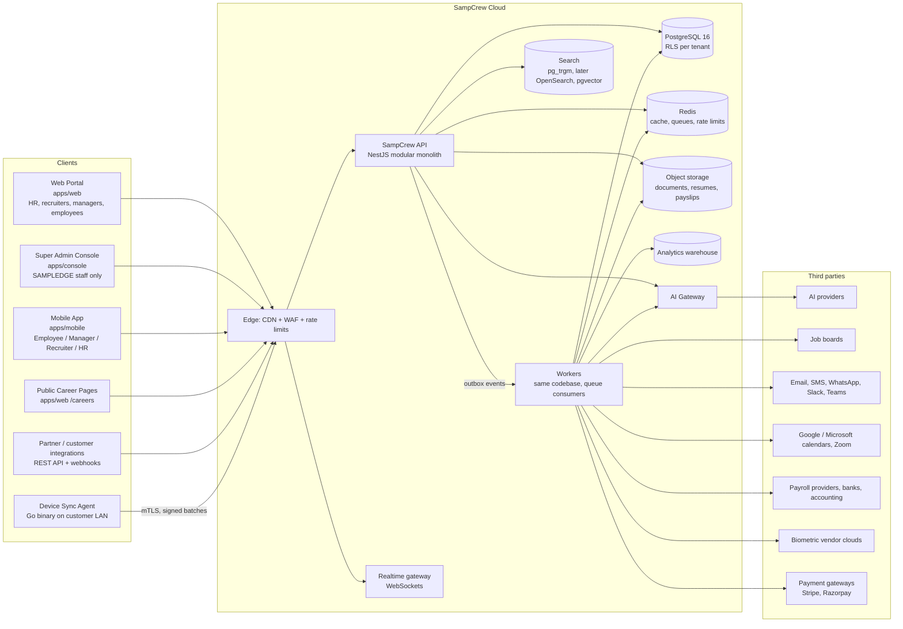

# 2. Application Architecture

## 2.1 System context



## 2.2 Inside the API: the modular monolith

The API is one deployable with strict domain modules. Each module owns its tables, exposes an application service interface and publishes domain events. Modules never import another module's repository or query its tables directly.

```
apps/api/src
├── platform/          cross-cutting kernel (no business rules)
│   ├── config/        typed env loading, fail-fast validation
│   ├── database/      pool, tenant-scoped transactions (RLS), platform (bypass) access
│   ├── context/       request context (AsyncLocalStorage): tenant, actor, request id
│   ├── auth/          tokens, password hashing, MFA, guards
│   ├── authz/         RBAC + ABAC policy engine, @RequirePermission decorator
│   ├── entitlements/  feature gating by subscription, @RequireFeature decorator
│   ├── audit/         append-only, hash-chained audit trail
│   ├── events/        transactional outbox + dispatcher
│   ├── idempotency/   Idempotency-Key handling for unsafe requests
│   └── http/          error envelope, pagination, rate limiting
├── modules/
│   ├── identity/        users, memberships, sessions, MFA
│   ├── tenancy/         tenants, settings, onboarding
│   ├── organization/    legal entities, business units, locations, departments
│   ├── access/          roles, permissions, role assignments
│   ├── billing/         plans, features, subscriptions, invoices, usage
│   ├── platform-admin/  Super Admin Console APIs (separate auth realm)
│   ├── people/          Phase 2: employees, lifecycle, documents
│   ├── leave/           Phase 2
│   ├── time/            Phase 3: attendance engine, devices, shifts
│   ├── recruiting/      Phase 4: requisitions, candidates, ATS
│   ├── payroll/         Phase 5
│   ├── talent/          Phase 6: performance, learning, engagement
│   ├── automation/      Phase 8: workflow studio, approvals engine
│   ├── ai/              Phase 8: AI gateway, agents, knowledge base
│   └── integrations/    Phase 9: marketplace, connectors, webhooks
└── main.ts
```

### Request pipeline

```mermaid
sequenceDiagram
  participant C as Client
  participant M as Middleware
  participant G as Guards
  participant H as Handler
  participant DB as PostgreSQL
  C->>M: HTTPS request (Bearer token or cookie, X-Request-Id, Idempotency-Key)
  M->>M: request id, rate limit, security headers
  M->>G: AuthGuard: verify JWT, load session (revocation check)
  G->>G: TenantGuard: token tenant must match route tenant
  G->>G: EntitlementGuard: plan includes feature?
  G->>G: PermissionGuard: RBAC check, ABAC scope resolved
  G->>H: validated DTO (zod)
  H->>DB: BEGIN; SET LOCAL app.tenant_id, app.user_id
  H->>DB: business queries (RLS filters every row)
  H->>DB: INSERT audit_event, INSERT outbox_event
  H->>DB: COMMIT
  H-->>C: response envelope
```

## 2.3 Tenant model

```
Tenant (customer account, billing unit, isolation boundary)
 └── Legal entities (companies, per country, currency, fiscal year)
      └── Business units
      └── Locations (sites, branches, factories; geofence, timezone)
      └── Departments (tree)
 └── Users (identity) ── Memberships (user ↔ tenant, roles, employee link)
```

- A **user** identity is global (one email, one password, one MFA secret) and can belong to several tenants through **memberships**. Recruitment agencies and HR outsourcers need this.
- Every request runs in exactly one tenant. The access token names the tenant; switching tenant issues a new token.
- SAMPLEDGE staff use **separate platform accounts** in a separate table and a separate login. They can see tenant data only through audited, time-boxed **support access grants** that the tenant owner approves.

## 2.4 Data isolation layers

1. **Network/edge**: WAF, per-tenant and per-IP rate limits.
2. **Token**: the tenant id is a signed claim; it cannot be chosen by the client per request.
3. **Application**: guards check membership, permission and entitlement.
4. **Database**: RLS policies `tenant_id = current_setting('app.tenant_id')::uuid` on every tenant table; the API's database role has no `BYPASSRLS`.
5. **Storage**: object keys are prefixed `tenants/{tenantId}/...`; signed URLs are issued only after an authorisation check.
6. **Jobs**: every job payload carries `tenantId`; the worker opens a tenant-scoped transaction before touching data.
7. **Search/analytics**: every index document carries `tenant_id`; queries are always filtered server-side.

## 2.5 Events, workflows and integrations

- **Transactional outbox**: domain events are written in the same transaction as the change, then dispatched by a worker to in-process subscribers, the automation engine, webhooks and the warehouse. At-least-once delivery, consumers are idempotent.
- **Automation engine** (Phase 8) subscribes to events (`candidate.offer_accepted`, `attendance.shift_missed`, ...) and runs versioned workflow definitions with approvals, delays and retries.
- **Integration adapters** implement a common `Connector` interface (connect, verify, sync, handle webhook, revoke) with credentials stored encrypted per tenant.

## 2.6 Environments

| Environment | Purpose | Data |
|---|---|---|
| local | developer machines, docker compose | seeded demo data, clearly labelled |
| test | CI, ephemeral Postgres per run | fixtures created by tests |
| staging | pre-production, production-like infra | synthetic data only |
| production | customers | real data, region-pinned (IN, EU, US to start) |

Production is deployed per region ("cells") so data residency rules (DPDP, GDPR) can be honoured by pinning a tenant to a region.

## 2.7 Scaling path

1. Scale API and workers horizontally (stateless).
2. Read replicas for reports; warehouse for analytics.
3. Partition high-volume tables (`attendance_events` by month, `audit_events` by month).
4. Split hot modules (attendance ingestion, AI gateway, notifications) into separate deployables. They already talk via events, so the split is mostly deployment work.
5. Dedicated cells for very large enterprise tenants.
