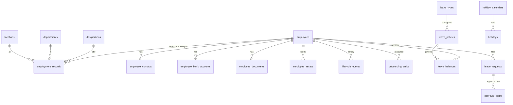
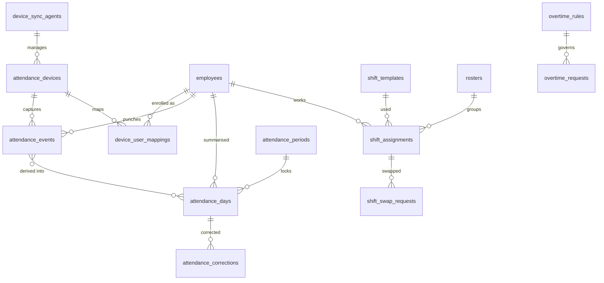
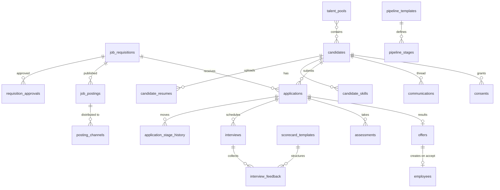
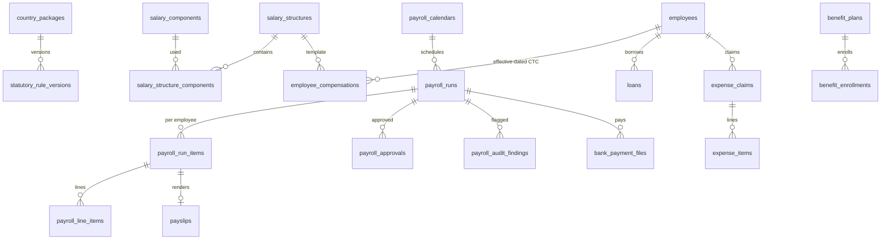
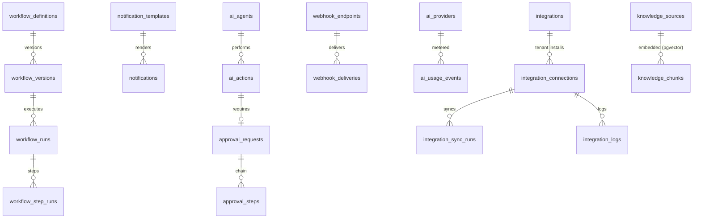

# 3. Database Entity Relationship Design

## 3.1 Conventions

- PostgreSQL 16, one database, schema `public` for tenant data and `platform` concepts in clearly prefixed tables.
- Primary keys: `uuid` generated by `gen_random_uuid()` (UUIDv7 planned for index locality).
- Every tenant-owned table has `tenant_id uuid not null references tenants(id)`, an RLS policy, and every index that serves tenant queries starts with `tenant_id`.
- Timestamps `created_at`, `updated_at` as `timestamptz`; soft delete via `archived_at` where business records must be retained.
- Money: `numeric(18,4)` plus an ISO-4217 `currency` column. Never floating point.
- Effective dating for anything that changes over time and affects pay or compliance: `effective_from date`, `effective_to date null`, exclusion constraints prevent overlaps.
- Raw facts are immutable: `attendance_events`, `audit_events`, finalised `payroll_run_items` reject UPDATE/DELETE via triggers. Corrections are new rows that reference the original.
- Sensitive columns (bank account, national IDs, tax IDs) are encrypted at the application layer with per-tenant data keys (envelope encryption via KMS) and stored as `bytea`; a separate `*_last4` column supports display.

## 3.2 Foundation (implemented in Phase 1)

```mermaid
erDiagram
  tenants ||--o{ legal_entities : owns
  tenants ||--o{ business_units : owns
  tenants ||--o{ locations : owns
  tenants ||--o{ departments : owns
  tenants ||--o{ memberships : has
  tenants ||--o{ roles : defines
  tenants ||--|| subscriptions : "current"
  tenants ||--o{ audit_events : records
  users ||--o{ memberships : joins
  users ||--o{ sessions : opens
  memberships ||--o{ role_assignments : granted
  roles ||--o{ role_permissions : contains
  roles ||--o{ role_assignments : assigned
  departments ||--o{ departments : parent
  legal_entities ||--o{ locations : hosts
  legal_entities ||--o{ departments : hosts
  plans ||--o{ plan_features : includes
  features ||--o{ plan_features : "in"
  plans ||--o{ subscriptions : priced
  subscriptions ||--o{ subscription_addons : extends
  tenants ||--o{ invoices : billed
  tenants ||--o{ usage_records : meters
  platform_admins ||--o{ support_access_grants : requests
  tenants ||--o{ support_access_grants : approves

  tenants {
    uuid id PK
    text slug UK
    text name
    text status
    text region
    text default_timezone
    text default_currency
    text default_locale
    bool is_demo
  }
  users {
    uuid id PK
    citext email UK
    text password_hash
    text full_name
    text mfa_secret_enc
    bool mfa_enabled
    timestamptz email_verified_at
    text status
  }
  memberships {
    uuid id PK
    uuid tenant_id FK
    uuid user_id FK
    text status
    uuid employee_id
    uuid department_id
    uuid manager_membership_id
    uuid location_id
    uuid legal_entity_id
  }
  roles {
    uuid id PK
    uuid tenant_id FK
    text key
    text name
    bool is_system
  }
  role_permissions {
    uuid role_id FK
    text permission
    text scope
  }
  role_assignments {
    uuid id PK
    uuid tenant_id
    uuid membership_id FK
    uuid role_id FK
    jsonb constraints
  }
  sessions {
    uuid id PK
    uuid user_id FK
    uuid tenant_id
    text refresh_token_hash
    timestamptz expires_at
    timestamptz revoked_at
    inet ip
    text user_agent
  }
  legal_entities {
    uuid id PK
    uuid tenant_id
    text name
    text country_code
    text currency
    text registration_number
    int fiscal_year_start_month
    text timezone
  }
  business_units {
    uuid id PK
    uuid tenant_id
    text name
    text code
  }
  locations {
    uuid id PK
    uuid tenant_id
    uuid legal_entity_id
    text name
    text timezone
    numeric latitude
    numeric longitude
    int geofence_radius_m
  }
  departments {
    uuid id PK
    uuid tenant_id
    uuid parent_id
    uuid legal_entity_id
    text name
    text code
    uuid head_membership_id
  }
  audit_events {
    bigint id PK
    uuid tenant_id
    text actor_type
    uuid actor_id
    text action
    text resource_type
    text resource_id
    jsonb changes
    inet ip
    bytea prev_hash
    bytea hash
  }
  outbox_events {
    uuid id PK
    uuid tenant_id
    text type
    jsonb payload
    timestamptz published_at
  }
  plans {
    uuid id PK
    text key UK
    text name
    numeric price_per_employee_month
    numeric price_per_employee_year
    text currency
    int min_employees
  }
  features {
    text key PK
    text name
    text module
    text kind
  }
  plan_features {
    uuid plan_id FK
    text feature_key FK
    int limit_value
  }
  subscriptions {
    uuid id PK
    uuid tenant_id
    uuid plan_id
    text status
    text billing_cycle
    int seats
    date trial_ends_on
    date current_period_start
    date current_period_end
  }
  invoices {
    uuid id PK
    uuid tenant_id
    text number UK
    text status
    numeric total
    text currency
    date period_start
    date period_end
  }
  usage_records {
    uuid id PK
    uuid tenant_id
    text metric
    numeric quantity
    timestamptz occurred_at
  }
  platform_admins {
    uuid id PK
    citext email UK
    text password_hash
    text role
    bool mfa_enabled
  }
  support_access_grants {
    uuid id PK
    uuid tenant_id
    uuid platform_admin_id
    text reason
    timestamptz expires_at
    timestamptz approved_at
  }
```

## 3.3 People (Phase 2)

Key rules: `employees.employee_code` unique per tenant via a tenant-configurable sequence; `employment_records` are effective-dated (department, designation, manager, location, grade, employment type) so history and future-dated transfers both work; `memberships.employee_id` links a login to an employee record (an employee may have no login, and a recruiter at an agency may have a login without an employee record).

## 3.4 Time and attendance (Phase 3)

- `attendance_events` is append-only, partitioned monthly, deduplicated by `(tenant_id, source, source_event_id)`. It stores source (device, mobile, web, kiosk, QR, import), raw payload hash, capture time in UTC plus device local time, GPS fix and accuracy, and a verification method.
- `attendance_days` is recomputed by the attendance engine from events + shift + policy; it is never hand-edited. Manual changes go through `attendance_corrections` with approver and reason.
- `attendance_periods.locked_at` freezes days once payroll inputs are taken.

## 3.5 Recruitment (Phase 4)

Candidate deduplication uses normalised email, phone (E.164) and a fuzzy name+DOB key; merges are recorded in `candidate_merges` so they can be audited.

## 3.6 Payroll and finance (Phase 5)

A `payroll_run_item` stores the inputs snapshot (attendance days, LOP, compensation version, rule-package version) and the computed lines, so any finalised payslip can be reproduced exactly. Finalised runs are immutable; corrections are "off-cycle" or "arrears" runs referencing the original.

## 3.7 Talent, engagement, documents (Phase 6)

`goals`, `review_cycles`, `reviews`, `feedback_requests`, `pips`, `recognitions`, `courses`, `learning_paths`, `course_assignments`, `certifications`, `skills`, `employee_skills`, `surveys`, `survey_responses` (anonymity enforced by k-anonymity threshold on reports), `announcements`, `helpdesk_tickets`, `kb_articles`, `document_templates`, `generated_documents`, `signature_requests`.

## 3.8 Automation, AI, integrations, notifications (Phases 8-9)

`approval_requests` is generic (resource type + id) and shared by leave, attendance corrections, requisitions, offers, payroll and AI actions, so every module uses one approvals engine.

## 3.9 Indexing and constraints highlights

- `memberships (tenant_id, user_id)` unique; `roles (tenant_id, key)` unique; `departments (tenant_id, code)` unique where code not null.
- `audit_events (tenant_id, created_at desc)`, `(tenant_id, resource_type, resource_id)`.
- `attendance_events (tenant_id, employee_id, captured_at)` per partition; unique `(tenant_id, source, source_event_id)`.
- `candidates` GIN trigram indexes on name and email; `tsvector` over resume text.
- Check constraints for enums (status columns) so bad values cannot be inserted by any path.
- Exclusion constraint (btree_gist) on `employment_records (tenant_id, employee_id, daterange(effective_from, effective_to))` preventing overlapping job records.
