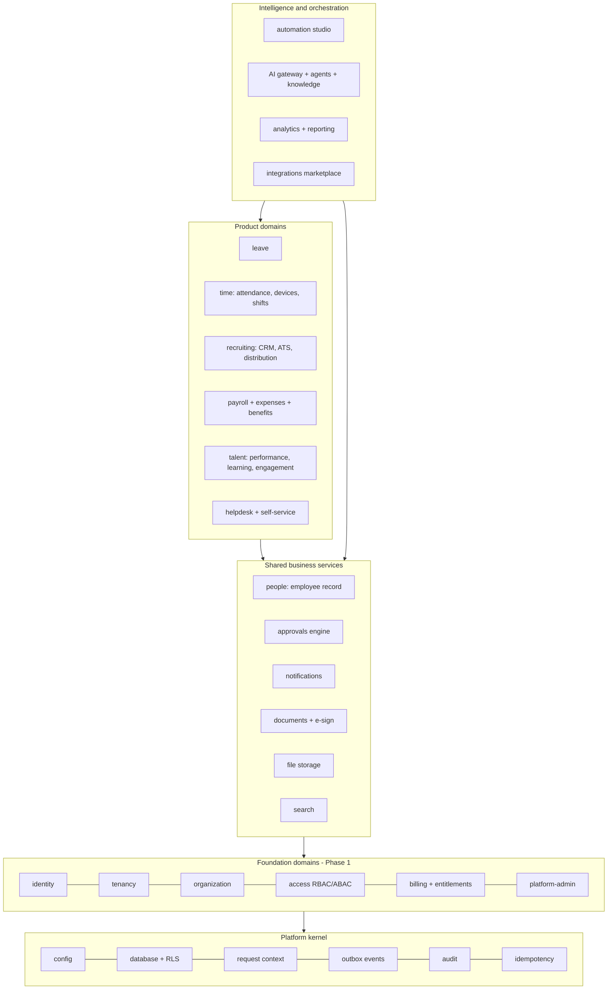

# 4. Module Dependency Architecture

All 34 product modules from the brief map onto a smaller set of **domain modules** in the API. Shared services (people, organisation, permissions, workflows, notifications, documents) exist once and every product module uses them, which is how CREW avoids duplicate records.

## 4.1 Layers



**Rule:** a module may depend only on modules in the same or a lower layer, and only through their exported service interfaces. Upward communication happens through domain events. An ESLint boundary rule enforces this in CI.

## 4.2 Product module → domain module mapping

| # | Brief module | Domain module | Depends on |
|---|---|---|---|
| 1 | Executive Intelligence Dashboard | analytics | all read models |
| 2 | Recruitment CRM | recruiting | people, notifications, integrations |
| 3 | Applicant Tracking System | recruiting | approvals, documents |
| 4 | Job Requisition Management | recruiting | organization, approvals, billing (headcount budget) |
| 5 | Job Distribution | recruiting + integrations | integrations (job board connectors) |
| 6 | Candidate Relationship Management | recruiting | notifications, consent |
| 7 | AI Recruitment Engine | ai | recruiting read models |
| 8 | Interview and Assessment | recruiting | integrations (calendar, video) |
| 9 | Employee Information System | people | organization, documents |
| 10 | Core HRMS | people | approvals, automation |
| 11 | Attendance Management | time | people, organization (locations) |
| 12 | Biometric Device Integration Hub | time.devices | integrations, device agent |
| 13 | Leave Management | leave | people, approvals, time (holidays) |
| 14 | Shift and Workforce Scheduling | time.scheduling | people, leave |
| 15 | Global Payroll | payroll | people, time, leave, expenses |
| 16 | Compensation and Benefits | payroll.compensation | people |
| 17 | Performance Management | talent | people |
| 18 | Learning and Development | talent | people, skills |
| 19 | Employee Engagement | talent.engagement | notifications |
| 20 | Employee Self-Service | (UI over all modules) | permissions with `own` scope |
| 21 | Manager Self-Service | (UI over all modules) | permissions with `team` scope |
| 22 | HR Helpdesk | helpdesk | ai.knowledge, notifications |
| 23 | Documents and E-Signatures | documents | file storage, integrations |
| 24 | Expenses and Reimbursements | payroll.expenses | approvals, file storage |
| 25 | Workforce Planning | analytics.planning | people, recruiting, payroll |
| 26 | AI HR Copilot | ai | every module's query tools |
| 27 | Workflow Automation Studio | automation | events from every module |
| 28 | Social and Communication Integrations | integrations + notifications | |
| 29 | HR Analytics and BI | analytics | warehouse |
| 30 | Compliance and Policy Management | compliance | documents, payroll packages |
| 31 | Integration Marketplace | integrations | billing (entitlements) |
| 32 | Multi-Company Administration | organization | |
| 33 | Super Admin Console | platform-admin | tenancy, billing, audit |
| 34 | Subscription and Billing | billing | |

## 4.3 Key cross-module events

| Event | Published by | Consumed by |
|---|---|---|
| `tenant.created` | tenancy | billing (trial), access (system roles), automation (default flows) |
| `membership.invited` / `.activated` | identity | notifications, audit |
| `org.department.changed` | organization | people, analytics |
| `employee.created` / `.transferred` / `.exited` | people | time, payroll, access (scope recompute), integrations |
| `candidate.offer_accepted` | recruiting | people (create employee), automation (onboarding) |
| `attendance.day_computed` / `.exception_raised` | time | payroll, notifications, automation |
| `leave.approved` | leave | time (mark leave days), payroll |
| `payroll.run_finalised` | payroll | documents (payslips), integrations (bank, accounting), notifications |
| `subscription.changed` | billing | entitlements cache, platform-admin |

## 4.4 Shared services contract examples

```ts
// people module public interface (Phase 2)
interface PeopleService {
  getEmployee(id: EmployeeId): Promise<EmployeeSummary>;
  createFromOffer(offer: AcceptedOffer): Promise<EmployeeId>; // used by recruiting
  orgContextFor(membershipId: string): Promise<AbacSubject>;   // used by authz
}

// approvals engine (shared)
interface ApprovalsService {
  request(input: { resourceType: string; resourceId: string; policyKey: string; requestedBy: string }): Promise<ApprovalRequestId>;
  decide(id: ApprovalRequestId, decision: 'approve' | 'reject', comment?: string): Promise<void>;
}
```
