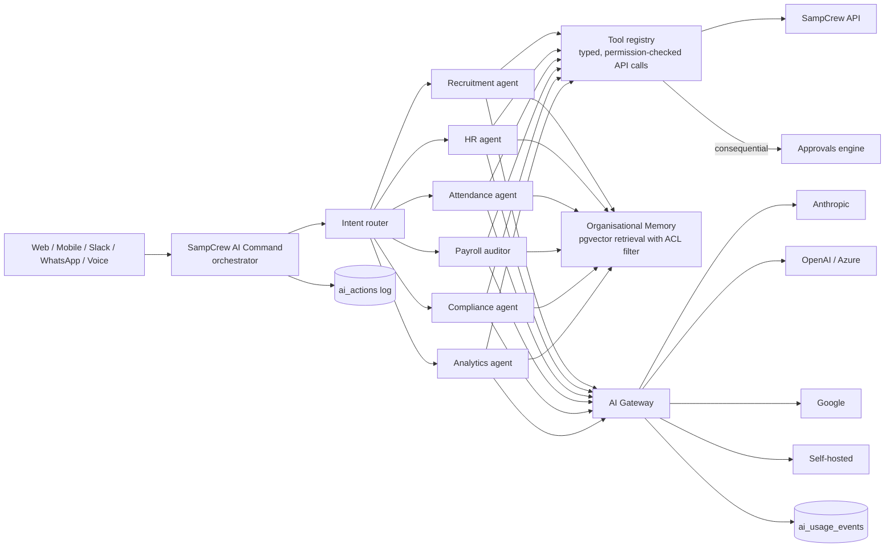
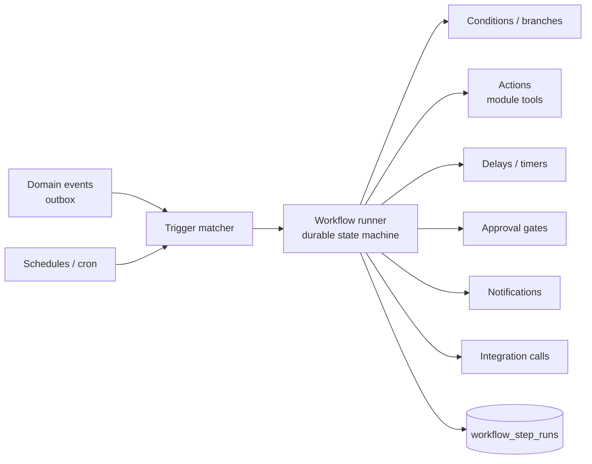

# 8. AI and Automation Architecture

## 8.1 Principles

1. **Permission-aware by construction.** An AI agent acts *as* the requesting user (or as a registered service agent with its own role). Every tool call goes through the same API authorisation and RLS as a human request. The model never receives data the user could not see.
2. **Human in the loop for consequential actions.** Hiring/rejection decisions, offers, terminations, compensation changes, payroll finalisation, disciplinary actions and bulk communications are always proposals that an authorised human approves.
3. **Explainable.** Every recommendation stores its inputs, the evidence it cited, the model and prompt version, and a human-readable rationale.
4. **Provider-agnostic and optional.** Tenants choose a provider, can bring their own key, can restrict data residency, and can disable AI per module.
5. **Metered.** Every model call records tokens, latency, cost and the feature that triggered it, rolled up into AI credits for billing.

## 8.2 Components

- **AI Gateway** (`modules/ai/gateway`): one interface (`complete`, `stream`, `embed`, `extract`) with adapters per provider, PII redaction hooks, per-tenant provider policy, retries with fallback provider, response caching for deterministic extraction, and cost accounting.
- **Tool registry**: each module registers tools with a zod input schema, the permission it requires, and a `consequential` flag. Consequential tools never execute directly; they create an `approval_request` with the AI's rationale attached.
- **Organisational Memory**: approved policy documents, SOPs and handbooks chunked and embedded into `knowledge_chunks` with the same visibility rules as the source document. Answers cite the source document and section.
- **Agents**: prompt + tool subset + guardrails per domain. Agents are registered as first-class "AI workers" with an owner, permissions, budget and execution history (the "Human + AI Workforce" capability).

## 8.3 Resume intelligence pipeline (Phase 4/8)

1. Upload → virus scan → text extraction (PDF/DOCX; OCR fallback).
2. Structured extraction with a JSON schema (contacts, experience, education, skills) via the gateway; deterministic parsers validate dates, emails and phones.
3. Skills normalised to the SampCrew skills taxonomy (ESCO/O*NET aligned).
4. Embedding stored for semantic search.
5. Job matching produces a score **with per-requirement evidence** ("5 yrs Java: found in roles at X and Y") and missing skills. Protected attributes (age, gender, religion, photos, names used as proxies) are excluded from matching inputs; bias monitoring compares pass-through rates across stages.

## 8.4 Automation Studio

- **Definition format**: versioned JSON graph (nodes: trigger, condition, action, delay, approval, notify, parallel, end) validated against a schema. The visual builder edits this JSON; AI "describe it in plain English" generates the same JSON, which must pass validation and a dry-run before an admin can activate it.
- **Execution**: durable runner backed by PostgreSQL state + BullMQ timers. Each step is idempotent and retried with exponential backoff; failures go to a dead-letter view with replay.
- **Safety**: workflows run with the permissions of their owning role, not unlimited system rights. Actions that would be consequential still route through approvals.
- **Testing**: "test run" mode executes against a sandbox copy of the trigger payload with side-effecting actions stubbed and shows the trace.

## 8.5 Predictive intelligence

Batch models run in workers over warehouse data: attrition risk (with top contributing factors, shown only to authorised HR, never to the employee's manager without policy approval), staffing gap forecasts, payroll anomaly detection (statistical baselines + rules), recruitment delay prediction. All outputs are advisory and explainable.

## 8.6 Data protection for AI

- Tenant data is never used to train shared models. Provider contracts must include zero-retention terms; tenants can restrict providers by region.
- Sensitive fields (bank, national IDs, health, biometric templates) are excluded from prompts by a field-level policy.
- Full prompt/response logs are kept per tenant retention policy and visible to the tenant's auditors.
