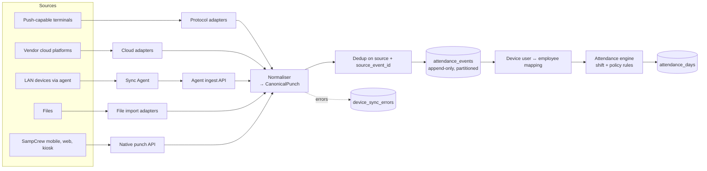

# 9. Attendance Hardware Integration Strategy

## 9.1 Goals

- Support many manufacturers without hardcoding any one of them.
- Never lose a punch: raw events are stored immutably and deduplicated.
- Work in factories with poor connectivity and devices that only speak on the local network.
- Show honest device status: a device is "online" only if SampCrew has heard from it within its expected interval.

## 9.2 Connection patterns

| Pattern | When | How it reaches SampCrew |
|---|---|---|
| **Device push (cloud)** | Device firmware supports pushing over HTTP(S) to a configurable server | Device → `https://ingest.crew.../devices/{protocol}/...` with per-device credentials |
| **Vendor cloud API** | Customer already uses the vendor's cloud/server software | SampCrew worker polls or receives webhooks from the vendor platform with tenant-supplied API credentials |
| **Local agent (LAN)** | Devices are reachable only inside the customer network, speak a TCP/SDK protocol, or the site is often offline | SampCrew Sync Agent (Go binary, Windows service / Linux systemd) on a site PC polls devices, buffers to local SQLite, pushes signed batches over mTLS |
| **File import** | Legacy devices, one-off migrations | CSV/DAT upload with a mapping template; same ingestion pipeline |
| **Mobile / web / kiosk / QR** | No hardware | SampCrew apps post punches directly |

## 9.3 Adapter architecture



```ts
interface DeviceAdapter {
  readonly vendor: string;              // 'zkteco', 'hikvision', ...
  readonly protocols: DeviceProtocol[]; // 'push-http', 'vendor-cloud', 'agent-tcp', 'file'
  capabilities(model?: string): DeviceCapabilities; // punches, user sync, face templates, remote unlock...
  verifyConnection(cfg: DeviceConfig): Promise<ConnectionCheck>;
  parseIncoming?(req: RawRequest): Promise<CanonicalPunch[]>;   // push adapters
  pull?(cfg: DeviceConfig, since: Cursor): Promise<PullResult>; // poll adapters
  pushUsers?(cfg: DeviceConfig, users: DeviceUser[]): Promise<SyncResult>;
}

interface CanonicalPunch {
  sourceEventId: string;   // vendor log id or hash(serial, deviceUserId, timestamp, state)
  deviceSerial: string;
  deviceUserId: string;    // enrolment number on the device
  capturedAtLocal: string; // as reported by the device
  capturedAtUtc: string;   // resolved using the device's configured timezone
  direction?: 'in' | 'out' | 'break_out' | 'break_in' | 'unknown';
  verifyMode?: 'fingerprint' | 'face' | 'card' | 'pin' | 'palm' | 'unknown';
  raw: unknown;            // original record, stored for audit
}
```

## 9.4 Vendor plan

Each adapter is built **only from the vendor's published documentation or SDK obtained under the vendor's terms**. Where a capability depends on firmware or a partner programme, the adapter declares it in `capabilities()` and the UI shows exactly what is supported for that model. Until real devices or credentials are available, every adapter ships with a **simulator** that produces protocol-shaped traffic for tests; simulated devices are visibly labelled "Simulated" in the dashboard.

| Vendor | Expected integration route (to confirm against vendor docs per model) | Priority |
|---|---|---|
| ZKTeco | Push protocol over HTTP on supported firmware; standalone SDK via local agent; BioTime server API where the customer runs it | P1 (largest installed base in India/SEA/MEA) |
| eSSL | Many models are ZKTeco-based and use the same push/SDK routes; validate per model | P1 |
| Matrix (COSEC) | COSEC server API / integration interfaces via the customer's COSEC installation | P1 (strong in Indian enterprises) |
| Hikvision | ISAPI over HTTP for access-control terminals, event subscription via agent or HTTP listening | P2 |
| Suprema | BioStar 2 server API | P2 |
| Realtime | Validate protocol per model (several use ZKTeco-compatible firmware) | P2 |
| Dahua | HTTP API for access-control devices via agent | P3 |
| Anviz | CrossChex Cloud / CrossChex Standard integration | P3 |
| HID | Through access-control platforms and partner programmes; HID is mostly readers and controllers, so integration is via the controlling software | P3 |
| Mantra | Primarily fingerprint scanners and Aadhaar RD-service devices; attendance terminals validated per model | P3 |

## 9.5 Sync Agent

- Single Go binary, auto-update channel signed with SAMPLEDGE's code-signing key.
- Enrolled with a one-time code from the dashboard; receives a client certificate (mTLS) scoped to one tenant and site.
- Polls configured devices on schedule, stores punches in local SQLite with a durable cursor per device, uploads in batches with idempotency keys. Survives days offline.
- Heartbeat every 60 s with per-device reachability, record counts, clock drift and error codes, which feed the device health dashboard.
- Remote configuration only via signed instructions from the API; the agent opens no inbound ports.

## 9.6 Device management dashboard (Phase 3)

Per device: manufacturer, model, serial, firmware, location, connection pattern, status (Online / Delayed / Offline / Simulated / Error), last sync, total/failed/pending records, clock drift, error log, employee mapping coverage (enrolled vs. unmapped device users), and sync configuration. Alerts fire on offline beyond threshold, unmapped users, or rising failures.

## 9.7 Privacy for biometrics

SampCrew stores **punch events, not biometric templates**, by default. Template sync between devices (where a customer needs it) is a separate, explicitly enabled feature with consent records, encryption and per-jurisdiction availability (for example, disabled by default where laws like Illinois BIPA require written consent). Facial verification in the mobile app is opt-in per tenant and per country.
