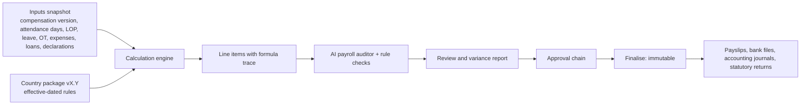

# 10. Global Payroll Strategy

## 10.1 Hybrid model

| Mode | What SampCrew does | Where |
|---|---|---|
| **Native** | SampCrew computes gross-to-net with its own engine and a validated country package | India first, then markets with demand and a compliance partner to validate |
| **Integrated** | SampCrew prepares inputs (attendance, leave, compensation changes, one-time payments), sends them to an authorised local provider, imports results and payslips | Every other country, via provider connectors |
| **Export-only** | SampCrew produces a reconciled payroll input file for the customer's existing processor | Fallback for any country |

All three modes share the same inputs, approvals, audit trail and reports, so a multinational sees one payroll calendar across countries.

## 10.2 Engine design



- **Decimal arithmetic only** (`decimal.js` in the engine, `numeric` in PostgreSQL), with explicit rounding rules per component and per country (for example, India PF rounding).
- **Formula components**: each salary component has a type (earning, deduction, employer contribution, reimbursement) and a calculation (fixed, percentage of another component, slab, formula in a safe expression language). Formulas are parsed and evaluated in a sandbox, never `eval`.
- **Explainability**: every line item stores the formula, inputs and rule-package version used, so a payslip can be explained and recomputed exactly.
- **Immutability**: finalised runs cannot change. Corrections are arrears or off-cycle runs referencing the original.
- **Proration and retro**: effective-dated compensation changes mid-period are prorated; backdated changes generate arrears in the next run.

## 10.3 Country packages

A country package is versioned code + data:

```
packages/payroll-in/
├── rules/2026-04-01/          effective-dated statutory parameters (slabs, ceilings, rates)
├── components/                PF, ESI, PT (per state), LWF (per state), TDS
├── calculators/               pure functions, fully unit tested
├── reports/                   ECR (EPFO), ESI return, Form 16 / 24Q data, PT returns
└── tests/golden/              expert-verified test cases
```

**India scope (Phase 5):** configurable CTC structures; Basic/HRA/special allowance; EPF (employee/employer, EPS split, wage ceiling, voluntary PF); ESI (eligibility threshold, contribution periods); Professional Tax by state; Labour Welfare Fund by state; TDS under old and new regimes with declarations and proof workflow; Payment of Bonus Act; gratuity accrual and payout; leave encashment; full and final settlement; statutory reports.

**Validation rule:** a country package is marked **Validated** in the product only after (1) golden test cases prepared or reviewed by a qualified payroll/tax professional pass, and (2) a parallel run against a known-correct payroll matches. Until then the UI labels the package "Preview, not for statutory filing". SampCrew never claims compliance it has not validated.

## 10.4 AI payroll auditor

Rule checks plus statistical baselines per employee and per component flag: month-over-month variance beyond thresholds, attendance vs. paid-days mismatch, overtime without approved requests, duplicate allowances, unexpected new deductions, missing bank details, employees in attendance but not in payroll (and vice versa), negative net pay, and approvals missing. Findings must be resolved or acknowledged with a reason before the approval step unlocks. Finalisation always requires an authorised human.

## 10.5 Integrated payroll connectors

Connectors implement `PayrollProviderAdapter` (`pushInputs`, `fetchResults`, `fetchPayslips`, `status`) and are built only against providers' published APIs under partner agreements. Until a partnership is in place, the connector exists as a configuration framework + sandbox simulator, and the export-only mode is available.
